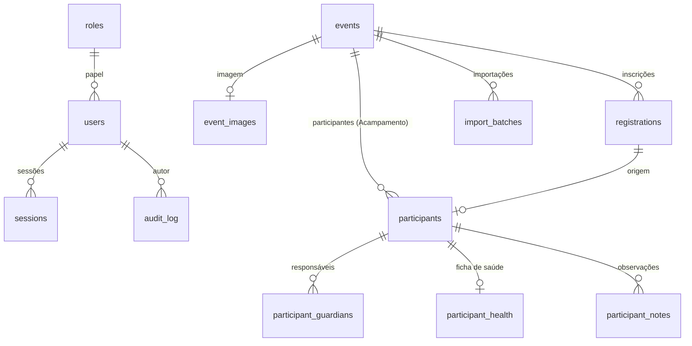

# Data Model: Painel administrativo, segurança e redesign do site

**Feature**: `001-painel-admin-redesign` | **Date**: 2026-11-16
**Banco**: Postgres (Neon) via Drizzle. Esquema em `lib/db/schema.ts`; migrações em `drizzle/`.

Convenções: nomes de tabela/coluna em inglês snake_case; `id uuid` gerado no banco
(`gen_random_uuid()`); `created_at`/`updated_at timestamptz default now()`; valores em dinheiro em
**centavos** (`integer`); textos de busca normalizados em colunas `*_key` (minúsculas, sem acento,
espaços simples); telefones normalizados só com dígitos.

## Diagrama



## Acesso

### roles

| Coluna | Tipo | Regras |
|---|---|---|
| id | uuid PK | |
| name | text | único, 2–60 caracteres |
| description | text | opcional, ≤ 200 |
| permissions | text[] | cada item ∈ lista fixa de `contracts/permissions.md` |
| is_system | boolean | papéis padrão; o papel Administrador não pode ser editado nem excluído |
| created_at, updated_at | timestamptz | |

Regras: não excluir papel com usuários; não remover `usuarios.gerenciar` de um papel se isso
deixar o sistema sem administrador ativo (FR-012).

### users

| Coluna | Tipo | Regras |
|---|---|---|
| id | uuid PK | |
| name | text | 2–100 |
| email | text | único, guardado em minúsculas, e-mail válido |
| password_hash | text | bcrypt custo 12; senha ≥ 8 caracteres |
| role_id | uuid FK → roles (restrict) | |
| active | boolean | default true |
| must_change_password | boolean | true na criação e na redefinição (FR-009) |
| last_login_at | timestamptz | nulo até o primeiro acesso |
| created_at, updated_at | timestamptz | |

"Administrador ativo" = usuário `active` cujo papel contém `usuarios.gerenciar`.
Transições: ativo ⇄ inativo (inativar apaga as sessões); excluir apaga sessões; nenhum dos dois é
permitido se ele for o último administrador ativo.

### sessions

| Coluna | Tipo | Regras |
|---|---|---|
| id | text PK | SHA-256 (hex) do token do cookie |
| user_id | uuid FK → users (cascade) | índice |
| expires_at | timestamptz | criação + 7 dias |
| created_at, last_seen_at | timestamptz | `last_seen_at` atualizado no máx. a cada 5 min |
| ip, user_agent | text | opcionais |

### audit_log

| Coluna | Tipo | Regras |
|---|---|---|
| id | uuid PK | |
| actor_user_id | uuid FK → users (set null) | nulo para ações anônimas (login com falha) |
| actor_label | text | nome/e-mail no momento da ação |
| action | text | ex.: `auth.login_failed`, `registration.delete`, `participant.health_view` |
| entity_type, entity_id | text | registro afetado |
| summary | text | frase legível |
| metadata | jsonb | detalhes (filtros da exportação, quantidades) |
| ip | text | |
| created_at | timestamptz | índice desc |

Ações registradas (FR-006): login com falha e bloqueio; acesso negado; criação/edição/
desativação/exclusão/redefinição de senha de usuário; criação/edição/exclusão de papel; mudança de
status e exclusão de inscrição; exportações; acesso a ficha de saúde; importação, mescla e exclusão
de participantes; exclusão em lote; exclusões de evento/devocional/mensagem; execução da virada.

### entity_history

Histórico por registro (FR-018, FR-028).

| Coluna | Tipo |
|---|---|
| id | uuid PK |
| entity_type | text (`registration` \| `participant`) |
| entity_id | uuid |
| field | text |
| old_value, new_value | text |
| actor_user_id | uuid FK → users (set null) |
| actor_label | text |
| created_at | timestamptz |

Índice `(entity_type, entity_id, created_at)`.

## Conteúdo

### events

| Coluna | Tipo | Regras |
|---|---|---|
| id | uuid PK | |
| slug | text | único, `[a-z0-9-]`, gerado do título e editável |
| title | text | 3–120 |
| summary | text | ≤ 200 (cartões) |
| description | text | ≤ 5.000, texto com parágrafos |
| starts_at | timestamptz | obrigatório |
| ends_at | timestamptz | opcional, ≥ starts_at |
| location_name, location_address | text | opcionais |
| location_map_url | text | URL http(s) opcional |
| image_id | uuid FK → event_images (set null) | |
| image_alt | text | obrigatório se houver imagem (FR-035) |
| category | text | ex.: Acampamento, Culto, Missões, Social |
| featured | boolean | só um evento publicado em destaque por vez (ao marcar, desmarca os outros) |
| publication | enum `draft` \| `published` \| `archived` | default `draft` |
| external_url, external_label | text | link externo opcional (eventos sem formulário) |
| form_model | enum `acampamento` \| `festa` \| `missao` \| `simples` | nulo = sem inscrição; imutável após a 1ª inscrição |
| form_config | jsonb | parâmetros do modelo (abaixo) |
| registration_open | boolean | default false |
| registration_closes_at | timestamptz | opcional; após essa data as inscrições ficam encerradas |
| version | integer | concorrência otimista |
| created_by | uuid FK → users (set null) | |
| created_at, updated_at | timestamptz | |

Transições de `publication`: draft → published → draft; qualquer → archived; archived → draft.
Exclusão física só sem inscrições e sem participantes (FR-036).
Inscrições aceitas quando: `publication = published` ∧ `form_model` não nulo ∧
`registration_open` ∧ (`registration_closes_at` nulo ou futuro) ∧ vagas/estoque disponíveis.
"Próximos eventos" públicos: `published` ∧ (`ends_at` ou `starts_at`) ≥ agora.

#### form_config por modelo

```ts
acampamento: {
  lotes: { rotulo: string; valorCentavos: number; validoAte: string /* YYYY-MM-DD */ }[]; // 1..12, datas crescentes
  descontoDuplaPct: number;      // 0..100 (padrão 15)
  descontoPixPct: number;        // padrão 5
  descontoDinheiroPct: number;   // padrão 10
  parcelasCarne: number;         // 1..12 (padrão 6); 0 = sem carnê
  permitirCredito: boolean;      // padrão true
}
festa: {
  valorContribuicaoCentavos: number; // padrão 4000
  vagasContribuicao: number;         // padrão 10
  itens: { nome: string; categoria: "comida" | "bebida"; quantidade: number }[];
}
missao: {
  permitirTempoIntegral: boolean;
  periodos: { id: string; rotulo: string }[]; // 1..20
}
simples: {}
```

### event_images

| Coluna | Tipo | Regras |
|---|---|---|
| id | uuid PK | novo id a cada troca (cache imutável) |
| data | bytea | ≤ 5 MB |
| mime | text | `image/jpeg` \| `image/png` \| `image/webp` (conferido pelos bytes iniciais) |
| size | integer | |
| created_at | timestamptz | |

### devotionals

| Coluna | Tipo | Regras |
|---|---|---|
| id | uuid PK | |
| title | text | 3–150 |
| reference_month | date | dia 1 do mês |
| url | text | URL http(s) válida |
| published | boolean | |
| published_at | timestamptz | preenchido ao publicar; ordena "mais recente" |
| version | integer | |
| created_at, updated_at | timestamptz | |

Ordenação pública: `published_at desc`, depois `reference_month desc`.

### messages

| Coluna | Tipo | Regras |
|---|---|---|
| id | uuid PK | |
| kind | enum `contato` \| `servir` | |
| name | text | obrigatório |
| email | text | contato |
| whatsapp | text | servir |
| ministry | text | servir |
| body | text | contato, ≤ 5.000 |
| status | enum `new` \| `read` \| `archived` | default `new` |
| email_sent_at | timestamptz | nulo se o e-mail falhou |
| email_error | text | |
| read_at | timestamptz | |
| created_at | timestamptz | |

Transições: new ⇄ read; new/read → archived; archived → read.

## Inscrições

### registrations

| Coluna | Tipo | Regras |
|---|---|---|
| id | uuid PK | |
| event_id | uuid FK → events (restrict) | |
| number | integer | sequencial por evento (único com event_id) |
| name | text | 3–100 |
| name_key | text | normalizado |
| phone | text | 10–20, dígitos/símbolos |
| phone_key | text | só dígitos |
| email | text | opcional (obrigatório no Acampamento) |
| status | enum `pending` \| `confirmed` \| `cancelled` | default `pending` |
| amount_cents | integer | valor final calculado no envio (FR-016) |
| answers | jsonb | respostas do modelo |
| payment | jsonb | Acampamento/Festa (abaixo) |
| created_at, updated_at | timestamptz | |

Único `(event_id, name_key, phone_key)` (FR-021). Índices `(event_id, status)`, `(event_id, created_at)`.

```ts
answers.acampamento = { idade: number; igreja: string; cidade: string;
  dupla: "nao" | "irmao" | "conjuge"; nomeDupla?: string; quantidadePessoas: number;
  plano: "avista" | "carne" | "credito"; formaPagamento?: "pix" | "dinheiro" | "cartao" }
answers.festa = { faixaEtaria: "12-17" | "18-35"; tipoParticipante: "membro" | "convidado";
  convidadoPor?: string; observacao: "normal" | "nao_consigo";
  tipoContribuicao?: "alimento" | "valor"; itens?: string[] }
answers.missao = { tempoIntegral: boolean; periodos: string[] }
answers.simples = { observacao?: string }

payment = { lote?: string; valorOriginalCentavos: number; valorFinalCentavos: number;
  plano?: string; forma?: string;
  parcelas: { rotulo: string; valorCentavos: number; pago: boolean; pagoEm?: string }[] }
```

Transições de `status`: pending → confirmed | cancelled; confirmed → pending | cancelled;
cancelled → pending. Cada mudança (inclusive de parcela paga) gera `entity_history`.

## Participantes do acampamento

### participants

| Coluna | Tipo | Regras |
|---|---|---|
| id | uuid PK | |
| event_id | uuid FK → events (restrict) | evento com `form_model = acampamento` (FR-031a) |
| number | integer | sequencial por evento |
| registration_id | uuid FK → registrations (set null) | único quando presente |
| name, name_key | text | |
| sex | enum `M` \| `F` | opcional |
| birth_date | date | idade calculada na exibição |
| cpf, rg | text | CPF só dígitos, 11 |
| church, city, address | text | |
| mobile, whatsapp, email | text | |
| emergency_contact | jsonb `{ nome, parentesco?, telefone }` | |
| authorization_declared | boolean | |
| source | enum `registration` \| `import` \| `manual` | |
| import_batch_id | uuid FK → import_batches (set null) | |
| version | integer | |
| created_at, updated_at | timestamptz | |

Índices `(event_id, name_key)`, `(event_id, cpf)`, `(event_id, mobile)`.
"Pendente de responsável": idade < 18 e nenhum `participant_guardians`.

### participant_guardians

| Coluna | Tipo |
|---|---|
| id | uuid PK |
| participant_id | uuid FK → participants (cascade) |
| name, relationship, phone | text (obrigatórios) |
| whatsapp, email, address, notes | text |
| position | integer |

### participant_health (dado sensível — só com `participantes.saude.*`)

| Coluna | Tipo |
|---|---|
| participant_id | uuid PK/FK → participants (cascade) |
| blood_type | text |
| allergies | text[] |
| allergy_reaction, allergy_medication | text |
| medications | text[] |
| conditions | text[] (valores da lista FR-023: `alergia`, `asma`, `autismo`, `diabetes`, `epilepsia`, `problema_cardiaco`, `tdah`, `tda`, `ansiedade`, `depressao`, `deficiencia_auditiva`, `deficiencia_visual`, `deficiencia_motora`, `sindromes`, `outro`) |
| condition_details | text |
| disability, disability_details | text |
| dietary_restrictions | text[] |
| physical_restrictions | text |
| medical_notes | text[] |
| other_health_info | text |
| special_needs | boolean |
| special_needs_details | text |
| updated_at | timestamptz |

### participant_notes

| Coluna | Tipo |
|---|---|
| id | uuid PK |
| participant_id | uuid FK (cascade) |
| body | text (1–2.000) |
| author_user_id | uuid FK → users (set null) |
| author_label | text |
| created_at | timestamptz |

### import_batches

| Coluna | Tipo |
|---|---|
| id | uuid PK |
| event_id | uuid FK → events (cascade) |
| file_name | text |
| total_rows, created_count, updated_count, review_count | integer |
| mapping | jsonb (`{ coluna: campo }`) |
| actor_user_id | uuid FK → users (set null) |
| created_at | timestamptz |

### import_mappings

| Coluna | Tipo |
|---|---|
| signature | text PK (hash dos cabeçalhos normalizados) |
| mapping | jsonb |
| updated_at | timestamptz |

## Regras derivadas

- **Aviso de retenção (FR-031b)**: eventos `acampamento` com `coalesce(ends_at, starts_at) < now() - 60 dias`
  que ainda têm linhas em `participant_health`.
- **Mescla (FR-026)**: mantém o participante escolhido como principal; campos vazios recebem os
  valores do outro; listas (alergias etc.) são unidas sem repetição; responsáveis e observações
  são movidos; o outro é excluído; tudo numa transação, com `entity_history` e auditoria.
- **Repetidos na importação**: pontuação por CPF/e-mail/celular idênticos (exato) e semelhança de
  nome (Levenshtein normalizado) + data de nascimento; ≥ 0,95 → atualização sugerida; 0,7–0,95 ou
  mais de um candidato → revisão manual; < 0,7 → novo.
